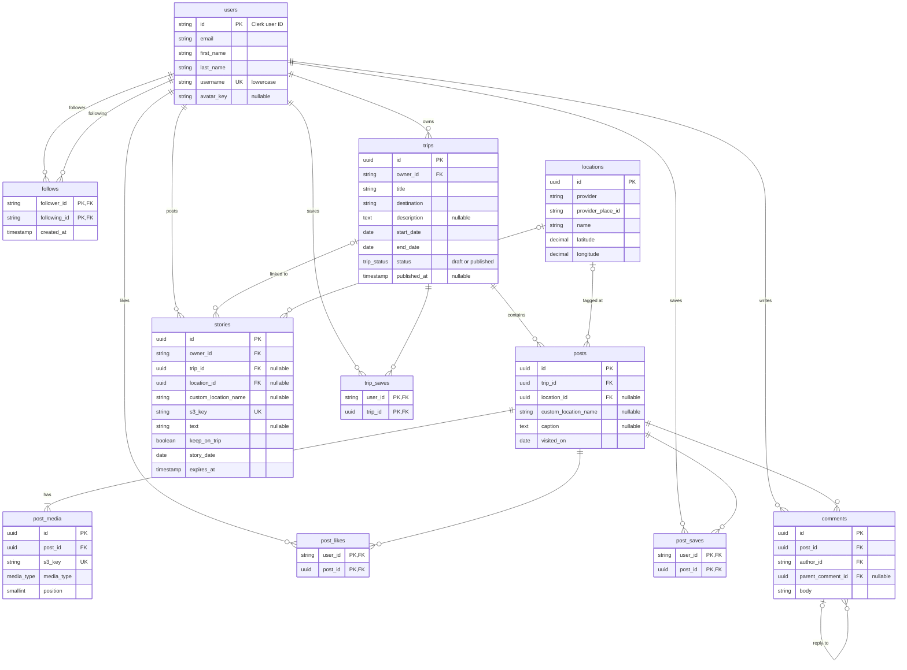

# MVP Data Model

Status: Proposed, for review by each table's owner
Issue: #33 (DOC-1)

## Overview

This doc is the proposed cross-feature data model for the Yuji MVP. It shows how every table connects, who builds each one, and what happens on delete. The product rules behind it are in [`docs/product/mvp-decisions.md`](../product/mvp-decisions.md).

The doc has three kinds of content:
- **Decided:** the relationships between tables and the delete rules. These come from the product decisions in #33, and they override any feature doc that disagrees.
- **Owner's design:** columns, indexes, and endpoints. Each table's owner decides these in their own doc and PR:
  - `authentication.md` for users (#15)
  - `follower-system.md` for follows (#16)
  - `itinerary-schema.md` for trips, posts, and locations (#17)
  - `stories.md` for stories (#23)
  - the docs that INT-1 and INT-2 will add for likes, saves, and comments
- **Suggestion (Christian):** a suggestion for that owner to accept or push back on in their PR.

When an owner confirms or changes their tables, update this doc to match. [Changes to open PRs](#changes-to-open-prs) lists what has to change in each one.

## Conventions

- Prisma models live in `apps/api/prisma/models/`, one file per model.
- Columns are snake_case (`@map`), and JSON is camelCase.
- Primary keys are UUIDs, except `users.id`, which is the Clerk user ID (a string like `user_123`). Every column that references a user is a string.
- Every foreign key has an explicit `onDelete`. There are no soft deletes: deleting something removes it (see [Deletion](#deletion)).
- We store S3 keys, never URLs. The API turns keys into URLs when it reads a row.
- Prisma can't express check constraints, so add them as raw SQL in the migration that creates the table.

## Relationships

Every table also has `created_at`. Tables whose rows can be edited (`users`, `trips`, `posts`, `locations`) also have `updated_at`.

The diagram includes Christian's suggested columns (`avatar_key`, `published_at`, `custom_location_name`, and no `posts.author_id`). They're labeled in [Tables](#tables), and they change if the owners decide otherwise. The relationships between tables are decided.

## Who builds what

| Table | Ticket | Owner | Where the columns come from | Confirmed? |
|---|---|---|---|---|
| `users` | #15 / #29 ACCT-1 | Lucy | Lucy's Prisma model in #15 | Built in #15, not merged yet |
| `follows` | #10 FOL-1 | Ruoxi | Ruoxi's doc in #16, with changes to match #15 | No, the changes need Ruoxi's review |
| `trips`, `posts`, `post_media`, `locations` | #3 DB-1 | Duke (Grace reviews `locations` in #37 LOC-1) | Duke's draft in #17, with changes for the #33 decisions | No, #17 is still a draft |
| `stories` | #23 STORY-1 | Richie | `stories.md` (#23), which takes both suggestions below | Built in #23, not merged yet |
| `post_likes`, `post_saves`, `trip_saves` | #49 INT-1 | Unassigned | The INT-1 ticket scope | No, not designed yet |
| `comments` | #50 INT-2 | Unassigned | The INT-2 ticket scope | No, not designed yet |

## Tables

Only the rules that cross features are listed here. Column types and lengths follow the limits in the product doc. Anything marked **Suggestion (Christian)** is for the owner to accept or change, and everything else in this section comes from the owner's doc or ticket.

### users

- Usernames are unique regardless of capitalization (decided in #33) and must match `^[a-z0-9_.]{3,30}$`.
- **Suggestion (Christian):** store `username` lowercase. The API lowercases it on every write, and the `@unique` constraint does the rest. That makes uniqueness case-insensitive without needing `citext`.
- Built in SRCH-1 ([`search.md`](search.md)): trigram GIN indexes on `username`, `first_name` and `last_name` for people search.
- **Suggestion (Christian):** replace `avatar_url` with `avatar_key`, the S3 key of an uploaded avatar, or null. If the user has no avatar, the app can fall back to Clerk's image. That lets account deletion find and delete the avatar along with everything else.

### follows

- Unique `(follower_id, following_id)`, and a check constraint that `follower_id <> following_id` (from #16).
- **Suggestion (Christian):** make `(follower_id, following_id)` the primary key instead of a separate unique constraint, and index `(following_id)` for follower lists. The primary key already covers following lists.

### trips

- `status` is `draft` or `published`, defaulting to `draft` (decided in #33).
- Check constraint: `end_date >= start_date` (from #17).
- **Active trip** (decided in #33): `status = 'draft' AND start_date <= today AND today <= end_date`.
- **Suggestion (Christian):** add `published_at`, with the check constraint `(status = 'published') = (published_at IS NOT NULL)`. The feed sorts trips by it.
- **Suggestion (Christian):** compute "today" from the date in the user's time zone, sent by the app, not the server's date.
- **Suggestion (Christian):** index `(owner_id, start_date)` for profiles and the active-trip lookup, and `(status, published_at)` for the feed.

### posts

- `trip_id` is required (decided in #33).
- Each post has one location (decided in #33).
- **Suggestion (Christian):** drop `author_id`. A post's author is always its trip's owner, so it can be read through `trips.owner_id`, and the two can never disagree.
- **Suggestion (Christian):** store a custom location as a name on the post, not as a `locations` row:
  - Exactly one of `location_id` and `custom_location_name` is set, enforced by the check constraint `(location_id IS NULL) <> (custom_location_name IS NULL)`.
  - That way a location row never belongs to one user, which keeps account deletion simple.
- `visited_on` is required, and the API rejects one outside the trip's dates (decided in #33). The database doesn't check this, because the trip's dates can change.
  - Posts within a trip are ordered by `visited_on`, then `created_at`.
- **Suggestion (Christian):** index `(trip_id, visited_on, created_at)` for the trip page and `(location_id)` for the map and location pages.

### post_media

- Up to 30 items per post (decided in #33).
- From #17:
  - Unique `(post_id, position)`.
  - `media_type` is an enum: `image` or `video`.
  - `width`, `height`, and `duration_ms` are optional metadata.
- **Suggestion (Christian):** enforce the 30-item cap with the check constraint `position BETWEEN 0 AND 29`.

### locations

- From #17:
  - Unique `(provider, provider_place_id)`. `provider` is `mapbox` for now.
  - `address`, `city`, `region`, and `country_code` are optional.
  - Index `(latitude, longitude)` for map bounding-box queries. We can move to PostGIS later if we need radius search.
- Built in SRCH-1 ([`search.md`](search.md)): trigram GIN indexes on `name`, `city` and `region` for place search.
- **Suggestion (Christian):** keep rows to Mapbox places only, with custom names stored on the post or story (see [posts](#posts)). Then a location never belongs to one user and is never deleted.
- Storage terms are pending #37 (LOC-1). If Mapbox doesn't allow storing coordinates permanently, this table changes.

### stories

- From the STORY-1 ticket (#23):
  - `trip_id` is optional, with the check constraint `NOT keep_on_trip OR trip_id IS NOT NULL`.
  - The API only accepts a `trip_id` for one of the user's active trips. The database can't check this, because "active" depends on today's date.
  - `expires_at` is `created_at + 24 hours`. Reads filter on it, so a story disappears on time even before the cleanup job deletes it.
- **Suggestion (Christian):** use the same location approach as posts, but optional. At most one of `location_id` and `custom_location_name` is set, enforced by `NOT (location_id IS NOT NULL AND custom_location_name IS NOT NULL)`.
- **Suggestion (Christian):** index `(owner_id, expires_at)` for the stories bar and `(trip_id)` for kept stories on a trip page.
- Built in #23 ([`stories.md`](stories.md)) with both suggestions. The indexes are `(owner_id, expires_at)` for the stories bar, `(trip_id, story_date, created_at)` so the trip page doesn't sort, and `(expires_at)` for the cleanup job.
- `story_date` (from the post-story wireframe; not in mvp-decisions.md yet): the day a story is from. With a trip, any day within the trip's dates; without one, today. It orders kept stories on the trip page and doesn't change expiry.

### post_likes, post_saves, trip_saves

- From the INT-1 ticket (#49): one like per user per post, and every like and save is idempotent.
- **Suggestion (Christian):** use the `(user_id, ...)` pair as each table's primary key. Then create with an upsert, and delete without checking that the row exists.
- **Suggestion (Christian):** add these indexes:
  - `post_likes (post_id, created_at)` for the likes list
  - `post_saves (user_id, created_at)` and `trip_saves (user_id, created_at)` for the Saved tab

### comments

- From #33 and the INT-2 ticket (#50):
  - `body` is 1 to 500 characters.
  - `parent_comment_id` is null for a top-level comment. A reply points to a top-level comment.
  - If someone replies to a reply, the server stores the new comment under that reply's top-level comment.
- **Suggestion (Christian):** have the API check that a reply's parent is on the same post, and index `(post_id, parent_comment_id, created_at)` for top-level lists and reply lists.

## Visibility

Visibility is decided by the trip.

`canView(viewer, trip)` is true when `trip.status = 'published'` or `trip.owner_id = viewer`.

- A post can be seen when its trip can be seen. A like, save, or comment on a post or trip someone can't see returns 404.
- Feed, map, search, location pages, and other users' profiles only include rows from published trips.
- **Suggestion (Christian):** put this rule in one query helper (for example, a Prisma `where` fragment exported from the trips module) so the feed, map, search, and profile services don't each rewrite it.
- Your own profile includes your drafts.
- A story can be seen while `expires_at` is in the future. After that, it can only be seen if `keep_on_trip` is true and the viewer can see its trip.
- **Suggestion (Christian):** an unpublished trip, or a post in one, returns 404 to anyone but the owner, not 403, so we don't reveal that it exists.

## Deletion

There are no soft deletes. Deleting a row deletes everything under it through `ON DELETE CASCADE`.

| Foreign key | On delete |
|---|---|
| Any `*.user_id`, `*.owner_id`, `*.author_id`, `follows.*` → `users` | Cascade |
| `posts.trip_id` → `trips` | Cascade |
| `stories.trip_id` → `trips` | Cascade (stories on a deleted trip are deleted, not unlinked) |
| `post_media.post_id`, `post_likes.post_id`, `post_saves.post_id`, `comments.post_id` → `posts` | Cascade |
| `trip_saves.trip_id` → `trips` | Cascade |
| `comments.parent_comment_id` → `comments` | Cascade (deleting a comment deletes its replies) |
| `posts.location_id`, `stories.location_id` → `locations` | Restrict (locations are shared and never deleted) |

### S3 objects

Cascades remove rows but not S3 objects, so every delete that removes media has to delete its S3 objects too (decided in #33).

**Suggestion (Christian):** every delete that removes media does this:

1. Read the S3 keys that are about to go: `post_media.s3_key`, `stories.s3_key`, and `users.avatar_key`.
2. Delete the rows in one transaction.
3. After the transaction commits, delete the objects with `DeleteObjects`, in batches of up to 1,000 keys.

If step 3 fails, log the keys and leave the delete in place. An object without a row is harmless and can be swept later. A row without an object is a broken image.

**Suggestion (Christian):** if uploads use keys under `users/{userId}/` (the key scheme is set in #38 MEDIA-1), account deletion can also remove everything with one prefix delete, which also catches uploads that never made it into a post.

### Account deletion

`DELETE /api/me` (#15, #29) deletes everything (decided in #33). **Suggestion (Christian):** do it in this order:
1. Collects the user's S3 keys, or uses the `users/{userId}/` prefix.
2. Deletes the `users` row. The cascades remove everything they own and everything they did on other people's content.
3. Deletes the S3 objects.
4. Deletes the Clerk user through Clerk's backend API.

Clerk then sends `user.deleted`. The webhook handler treats a user who's already gone as success.

### Expired stories

A scheduled job (#23 STORY-1) deletes stories where `expires_at < now()` and `keep_on_trip` is false, then deletes their S3 objects the same way.

## Changes to open PRs

Each list separates **Required** changes, which come from the #33 decisions, from **Suggestions (Christian)**, which the owner can accept or push back on in review.

### #15 (auth and users, Lucy)

Required:
- Usernames: 3 to 30 characters, only letters, numbers, `_` and `.`, and unique regardless of capitalization.
- Validate first and last names as 1 to 50 characters each.
- `DELETE /api/me`: hard delete everything, as described in [Account deletion](#account-deletion).
- Update the open questions in `authentication.md`: the webhook creates the user, and deletion is an immediate hard delete.

Suggestions (Christian):
- Lowercase `username` on create and update, so the existing `@unique` makes it case-insensitive.
- Replace `avatar_url` with `avatar_key` (an S3 key, nullable). The API returns `avatarUrl` built from the key.

### #16 (follower system, Ruoxi)

Required:
- Make `follower_id` and `following_id` strings (Clerk IDs), not UUIDs, to match #15.
- Cascade both foreign keys on user delete.
- Make follow and unfollow idempotent: a repeat follow returns the existing follow, not 409, and a repeat unfollow returns 204, not 404. Following yourself still returns 400, and a user who doesn't exist still returns 404.
- List rows: return `id`, `username`, `firstName`, `lastName`, `avatarUrl`, and `isFollowing` (whether the viewer follows that user), not `displayName`, since #15 has no display name.
- Paginate the follower and following lists with `{ items, nextCursor }` (#28 API-1).
- Remove the visibility notes, since everything is public.

Suggestions (Christian):
- Make `(follower_id, following_id)` the primary key, and index `(following_id)`.

### #17 (itinerary schema, Duke)

Required:
- **Visibility:** remove the `visibility` enum and columns, and replace the Visibility section with [Visibility](#visibility) above.
- **Trip status:** replace `planned` / `completed` with `draft` / `published`. Remove `rating` and its check constraint.
- **Trip fields:**
  - Add `destination` (required free text, up to 100 characters).
  - Make `start_date` and `end_date` required.
- **Posts belong to one trip:**
  - Add `posts.trip_id` (required, cascade).
  - Make `visited_on` required and within the trip's dates, and order posts by it.
  - Remove `trip_items`, the composite foreign key, the deferrable position constraint, and the trip item endpoints. `tripId` becomes required on `POST /api/posts`.
- **One location per post:** remove `post_locations` and replace `locationIds` with a single location.
- **Cuts:** remove `post_tagged_users`, `interests`, `post_interests`, and their endpoints and fields.
- **Media:** the limit is 1 to 30 items per post, not 10.
- **Deletion:**
  - Remove `deleted_at` and the soft-delete rules.
  - Trip and post deletes are hard deletes, including media and S3 objects.
  - `DELETE /api/trips/:id` deletes the trip's posts, media, and stories.
- **Endpoints:**
  - Add `POST /api/trips/:id/publish` (owner only). It rejects a trip with no posts (400), and publishing can't be undone.
  - Add an endpoint that returns the user's active trips, for the story composer.
  - `GET /api/users/:userId/trips` returns drafts only to the owner.

Suggestions (Christian):
- Add `published_at` to trips, for sorting the feed.
- Remove `cover_image_key`, and have the trip card use the first photo of its first post.
- Remove `posts.author_id`, and read the author through the trip.
- Store custom locations as `posts.custom_location_name` next to a nullable `posts.location_id`, with the exactly-one check constraint, instead of as `locations` rows. `locationIds` then becomes `locationId` or `customLocationName`.
- Use `provider = "mapbox"` in examples, not `google`.
- Publishing an already-published trip succeeds without changing it.
- Name the active-trips endpoint `GET /api/me/trips/active`.
