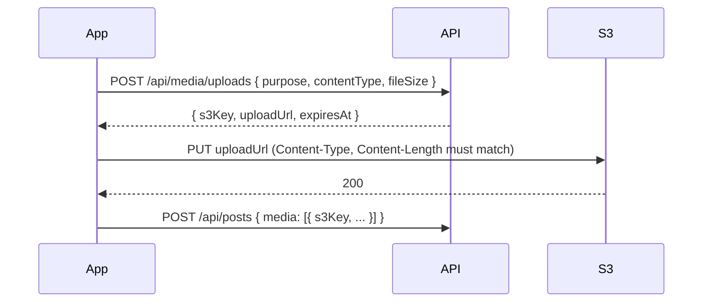

# Media Uploads

Status: Backend built, mobile upload hook in progress
Issue: #38 (MEDIA-1)

## Overview

Photos go straight from the app to S3 through a presigned PUT URL. The API never handles the file itself. The app asks the API for an upload URL, uploads the file to it, and then sends the returned `s3Key` to the post, story, or profile endpoint.

Posts, stories, and avatars all use this one endpoint. Video is #53 (MEDIA-2).



## Limits

From DOC-1 ([`docs/product/mvp-decisions.md`](../product/mvp-decisions.md)). Stories and avatars use the post photo rules.

| | Rule |
|---|---|
| Type | `image/jpeg` only |
| Size | 1 byte to 10 MB (10,485,760 bytes) |
| URL expiry | 15 minutes |

The app resizes each photo so its longest edge is at most 2,048 px and saves it as JPEG at about 80% quality before asking for a URL. The server enforces the type and size, not just the app:

1. The API rejects a request with any other `contentType` or a `fileSize` over 10 MB (`400`).
2. The content type and size are signed into the URL, so S3 rejects (`403`) an upload whose `Content-Type` or `Content-Length` header doesn't match the request.

## Key scheme

```
users/{userId}/posts/{uuid}.jpg
users/{userId}/stories/{uuid}.jpg
users/{userId}/avatars/{uuid}.jpg
```

- The server picks the key. The app can't choose one.
- The post and story endpoints check that each key starts with the current user's prefix (`users/{userId}/posts/` or `users/{userId}/stories/`), so a user can't attach someone else's upload.
- Everything a user uploads is under `users/{userId}/`, so account deletion can remove it all with one prefix delete (see [`data-model.md`](data-model.md#s3-objects)).

## Endpoint

### `POST /api/media/uploads`

Signed-in users only.

Request:
```json
{ "purpose": "post", "contentType": "image/jpeg", "fileSize": 2483021 }
```

- `purpose`: `post`, `story`, or `avatar`. Picks the folder in the key.
- `contentType`: `image/jpeg`.
- `fileSize`: the size in bytes of the file the app will upload, 1 to 10,485,760.

Response `201`:
```json
{
  "s3Key": "users/user_123/posts/6f1c2a4e-8b0d-4c57-9f3e-2d7a1b9c0e55.jpg",
  "uploadUrl": "https://<bucket>.s3.us-east-1.amazonaws.com/users/user_123/posts/...",
  "expiresAt": "2026-10-20T12:15:00.000Z"
}
```

Errors: `400` for an invalid body (see [API conventions](api-conventions.md)), `401` when not signed in.

Types are `CreateUploadRequest` and `CreateUploadResponse` in `shared-types`.

### Uploading to the URL

```
PUT {uploadUrl}
Content-Type: image/jpeg
Content-Length: {fileSize}

<file bytes>
```

- Both headers must match the request exactly.
- A URL is for one file. To retry an upload whose URL has expired, ask for a new one.
- Locally, without `S3_BUCKET_NAME` set, `uploadUrl` points at `https://media.invalid/<key>`, which never accepts an upload.

## Bucket setup (INF-1, #34)

The code needs no changes once the bucket exists. Set these on the API:

- `S3_BUCKET_NAME`: the media bucket.
- `AWS_REGION`: the bucket's region.

The API's credentials (the ECS task role on staging, or your AWS profile locally) need `s3:PutObject`, `s3:GetObject`, and `s3:DeleteObject` on `arn:aws:s3:::<bucket>/users/*`. A presigned URL can only do what the credentials that signed it can do.

The bucket stays private. The app uploads from native code, so the bucket doesn't need CORS for uploads. It only needs CORS if the app's web build uploads too.

## Orphaned uploads

An upload that never ends up in a post, story, or profile stays in S3. Nothing cleans these up yet. They're under the user's prefix, so account deletion still removes them.
