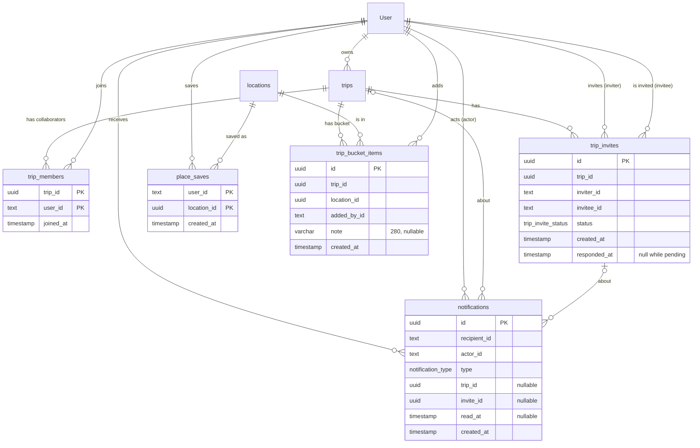

# Shared Trips, Buckets, Saved Places and Notifications

Issue: #131 (COLLAB-1)
Product rules: [`mvp-decisions.md`](../product/mvp-decisions.md) (#129 DOC-3)
Unblocks: #133 COLLAB-2, #134 COLLAB-3, #132 NOTIF-1, #135 PLACE-1, #136 BUCKET-1, and the UI issues #137 NOTIF-2, #138 COLLAB-4, #139 PLACE-2, #140 BUCKET-2

This is the contract for the whole batch: the tables, who can do what, and every endpoint's request, response and errors. The types are in [`apps/shared-types/src/collaboration.ts`](../../apps/shared-types/src/collaboration.ts). Each backend issue builds its own endpoints against this; each UI issue builds against the mocks in `apps/mobile/src/api/` and flips them to `live: true` as the endpoints merge.

## Overview

- A trip has one **owner** (`trips.owner_id`, unchanged) and up to 9 **collaborators** (`trip_members`), 10 people in all. Pending invites count toward the cap.
- The owner **invites** people by username (`trip_invites`). The invitee accepts or declines from their **notifications** (`notifications`).
- Every trip has a **bucket** (`trip_bucket_items`): places the members want to go, not scheduled onto days. Members only.
- Anyone can **save places** to their own account (`place_saves`), privately, like saved trips and posts.
- Only Mapbox places can be saved or added to a bucket. Custom locations belong to one post or story (#94 LOC-2), so PLACE-1 and BUCKET-1 reject `provider = 'custom'` with a 400.

## What's built where

| Part | Where | Status |
|---|---|---|
| Tables, migration, seed rows | `apps/api/prisma/models/`, `migrations/20261117133117_shared_trips` | This PR |
| `tripRole`, `MAX_TRIP_PEOPLE`, `MAX_BUCKET_PLACES` | `apps/api/src/trips/trip-rules.ts` | This PR |
| Notifications inbox: list, unread count, read-all | `apps/api/src/notifications/` | This PR (the main part of #132 NOTIF-1) |
| Accept and decline an invite | `apps/api/src/invites/` | This PR (part of #134 COLLAB-3) |
| Everything else in [Endpoints](#endpoints) | | Mocked, built in the issue listed |

## Data Model

### Tables

| Table | Keys and constraints | Indexes | Used by |
|---|---|---|---|
| `trip_members` | PK `(trip_id, user_id)`. Collaborators only; the owner isn't a row. | `(user_id, joined_at)` | Members list, `tripRole`, the Planning list |
| `trip_invites` | `status` is `trip_invite_status`: `pending`, `accepted`, `declined`, `cancelled`. Partial unique `(trip_id, invitee_id) WHERE status = 'pending'`. Checks: `inviter_id <> invitee_id`; `responded_at` is set exactly when status isn't `pending`. | `(trip_id, status)`, `(invitee_id)`, `(inviter_id)` | Pending invites and the people cap |
| `notifications` | `type` is `notification_type`: `trip_invite`, `trip_invite_accepted`. Checks: `recipient_id <> actor_id`; a `trip_invite` has `trip_id` and `invite_id`; a `trip_invite_accepted` has `trip_id`. | `(recipient_id, created_at, id)`, partial `(recipient_id) WHERE read_at IS NULL`, `(actor_id)`, `(trip_id)`, `(invite_id)` | The inbox and the unread badge |
| `place_saves` | PK `(user_id, location_id)` | `(user_id, created_at, location_id)`, `(location_id)` | The Saved tab's places, saved-in |
| `trip_bucket_items` | Unique `(trip_id, location_id)`. `note` up to 280 characters. | `(trip_id, created_at, id)`, `(added_by_id)`, `(location_id)` | The bucket, saved-in |

Notes:

- `notifications` is general on purpose. Later types (likes, comments, follows) add an enum value and reuse the table; `trip_id` and `invite_id` are nullable for them.
- Answered and cancelled invites stay, so the inbox can show what happened to each one. The partial unique index only covers pending invites, so the owner can invite someone again after they decline.
- The single-column indexes on `actor_id`, `inviter_id`, `added_by_id` and so on are there so deleting an account or trip doesn't scan these tables, and so the `RESTRICT` check is fast when LOC-2 deletes a custom pin.
- The partial indexes and the checks are raw SQL at the end of the migration, since Prisma can't express them. Each model file lists them in a comment.

### Deletion

Every foreign key to `User` and `trips` is `ON DELETE CASCADE`, and every foreign key to `locations` is `ON DELETE RESTRICT`, like posts. That gives #129 DOC-3's rules with no code: account deletion (`deleteUserRows`) already deletes the user row and lets cascades do the rest.

| Deleted | What goes with it |
|---|---|
| A trip | Its members, invites, bucket and notifications, for everyone |
| An account | Their memberships, invites (sent and received), notifications (received and caused), saved places, and the bucket places they added. Their own trips go too, with everything above, for every collaborator. |
| A collaborator leaving, or being removed | Only their `trip_members` row. The places they added stay in the bucket. |
| A location | Refused while it's saved or in a bucket. Only LOC-2's custom pins are ever deleted, and those can't be saved or added. |

`apps/api/test/collaboration.constraints.sql` checks all of this, plus the partial unique index and the checks. `test/constraints.e2e-spec.ts` runs it (and `follows.constraints.sql`) in CI.

## Permissions

`tripRole(prisma, tripId, viewerId)` in `trip-rules.ts` returns `'owner'`, `'collaborator'` or `null` (everyone else, or no such trip). Every check below starts there.

| Action | Owner | Collaborator | Everyone else |
|---|---|---|---|
| See the trip, including a draft's posts and stories | Yes | Yes, read-only | Only once published (today's rule) |
| Edit the trip's details, add or edit posts, publish, delete | Yes | No | No |
| Like, comment on or save the trip and its posts | Once published | Once published | Once published |
| See members | Yes | Yes | No |
| Invite, see pending invites, cancel an invite | Yes | No | No |
| Remove a collaborator | Yes | Only themselves (leaving) | No |
| Leave the trip | No | Yes | |
| See the bucket | Yes | Yes | No, before or after publishing |
| Add a place to the bucket | Yes | Yes | No |
| Edit a bucket place's note | Places they added | Places they added | No |
| Remove a bucket place | Any place | Places they added | No |
| Answer an invite | | | Only its invitee |

Letting collaborators see drafts means changing `visibleTripWhere` and `canViewTrip`. #133 COLLAB-2 owns that change; this PR leaves them alone.

Errors follow the API's usual rule: something you can't see is a 404, the same as something that doesn't exist. Something you can see but can't change is a 403. So a stranger gets 404 for a draft's members, and 403 for a published trip's members.

## Endpoints

All need a signed-in user. Errors use the [standard shape](api-conventions.md#error-response-shape); every endpoint can also return 400 for a body that fails validation or a malformed id. "Paginated" means `?cursor=&limit=` (1-50, default 20) and a `PaginatedResponse<T>`, using the [API-2 cursor helper](api-conventions.md#cursor-based-pagination) (#90); an invalid cursor is a 400. Members and invites are capped at `MAX_TRIP_PEOPLE`, so they come back whole as `{ items }`.

| Endpoint | Built in |
|---|---|
| `GET /api/trips/:id/members`, `DELETE /api/trips/:id/members/:userId`, `GET /api/me/trips/planning` | #133 COLLAB-2 |
| `POST /api/trips/:id/invites`, `GET /api/trips/:id/invites`, `DELETE /api/invites/:id` | #134 COLLAB-3 |
| `POST /api/invites/:id/accept`, `POST /api/invites/:id/decline` | This PR, for #134 COLLAB-3 |
| `GET /api/me/notifications`, `GET /api/me/notifications/unread-count`, `POST /api/me/notifications/read-all` | This PR, for #132 NOTIF-1 |
| `POST /api/locations/:id/save`, `DELETE /api/locations/:id/save`, `GET /api/me/saved/places` | #135 PLACE-1 |
| `GET /api/trips/:id/bucket`, `POST /api/trips/:id/bucket`, `PATCH /api/bucket-items/:id`, `DELETE /api/bucket-items/:id`, `GET /api/locations/:id/saved-in` | #136 BUCKET-1 |

### Members and the Planning list (#133 COLLAB-2)

**`GET /api/trips/:id/members`** → 200 `TripMembersResponse`
The owner first (`joinedAt` is when they created the trip), then collaborators by `joinedAt`.
- 403 you can see the trip but aren't on it
- 404 no such trip, or one you can't see

**`DELETE /api/trips/:id/members/:userId`** → 204
The owner removes a collaborator, or a collaborator passes their own id to leave. The places they added stay in the bucket. No notification.
- 400 the owner tries to remove themselves (they can't leave their own trip)
- 403 a collaborator tries to remove someone else
- 404 no such trip, one you can't see, or `userId` isn't a collaborator

**`GET /api/me/trips/planning`** → 200 paginated `PlanningTripResponse`
Trips you own or joined, drafts and published, by `startDate` then `id`, soonest first. Each is a `TripResponse` plus `myRole`, `memberCount` (everyone, counting the owner) and `bucketCount`. Joined trips don't show on your profile.

### Invites (#134 COLLAB-3)

**`POST /api/trips/:id/invites`** body `CreateTripInviteRequest` `{ username }` → 201 `TripInviteResponse`
Owner only. Anyone can be invited; following isn't required. Creates a `trip_invite` notification for the invitee. Takes a lock on the trip so two invites can't both pass the cap.
- 400 inviting yourself
- 403 you're a collaborator
- 404 no such trip, one you can't see, or no user with that username
- 409 they're already on the trip, already have a pending invite, or the trip has `MAX_TRIP_PEOPLE` people counting pending invites

**`GET /api/trips/:id/invites`** → 200 `TripInvitesResponse`
The trip's pending invites, newest first. Owner only.
- 403 you're a collaborator
- 404 no such trip, or one you can't see

**`DELETE /api/invites/:id`** → 200 `TripInviteResponse` with `status: 'cancelled'`
The owner cancels a pending invite. The invitee's notification stays and shows it as cancelled.
- 403 you're the invitee (decline instead)
- 404 no such invite, or one that isn't yours to see
- 409 it isn't pending anymore

**`POST /api/invites/:id/accept`** → 200 `TripInviteResponse` with `status: 'accepted'` (built)
The invitee joins as a collaborator, the owner gets a `trip_invite_accepted` notification, and the invite's own notification is marked read. Pending invites already count toward the cap, so accepting can't go over it. The status change is one conditional update, so answering twice, or racing the owner cancelling, can't both succeed.
- 404 no such invite, or someone else's (the owner can't answer for the invitee)
- 409 it isn't pending anymore

**`POST /api/invites/:id/decline`** → 200 `TripInviteResponse` with `status: 'declined'` (built)
Sends nothing to the owner, who can invite the same person again. Marks the invite's notification read.
- 404 and 409 as for accept

### Notifications (#132 NOTIF-1, built)

**`GET /api/me/notifications`** → 200 paginated `NotificationResponse`
Your notifications, newest first (`created_at`, then `id`). Each has the `actor`, a `trip` summary (`id`, `title`, `startDate`, `endDate`) and, for `trip_invite`, the invite's current `{ id, status }`, so an invite answered or cancelled elsewhere never offers Accept again. An invitee sees a draft's title and dates this way, which is intended.

**`GET /api/me/notifications/unread-count`** → 200 `UnreadCountResponse` `{ count }`
Uses the partial index, so it stays cheap as the inbox grows.

**`POST /api/me/notifications/read-all`** → 204
Marks everything read. The app calls it when the inbox opens.

### Saved places (#135 PLACE-1)

**`POST /api/locations/:id/save`** → 200 `PlaceSaveStatusResponse` `{ saved: true }`
**`DELETE /api/locations/:id/save`** → 200 `PlaceSaveStatusResponse` `{ saved: false }`
Both idempotent. Place saves are private, so there's no count.
- 400 a custom location (save only)
- 404 no such location

**`GET /api/me/saved/places`** → 200 paginated `SavedPlaceResponse` `{ location, savedAt }`
Newest save first (`created_at`, then `location_id`).

### Buckets (#136 BUCKET-1)

**`GET /api/trips/:id/bucket`** → 200 paginated `BucketItemResponse`
Newest first (`created_at`, then `id`). Members only, before and after publishing.
- 403 you can see the trip but aren't on it
- 404 no such trip, or one you can't see

**`POST /api/trips/:id/bucket`** body `CreateBucketItemRequest` `{ locationId, note? }` → 201 `BucketItemResponse`
Any member. `locationId` is a Mapbox place from `POST /api/locations/resolve`. Takes a lock on the trip so two adds can't both pass the cap.
- 400 a custom location, or a note over 280 characters
- 403 and 404 as for the bucket
- 404 no such location
- 409 the place is already in the bucket, or the bucket has `MAX_BUCKET_PLACES`

**`PATCH /api/bucket-items/:id`** body `UpdateBucketItemRequest` `{ note }` → 200 `BucketItemResponse`
Only on places you added. `null` clears the note.
- 400 a note over 280 characters
- 403 you're on the trip but didn't add it
- 404 no such item, or one on a trip you're not on

**`DELETE /api/bucket-items/:id`** → 204
Places you added, or any place if you own the trip.
- 403 a collaborator removing someone else's place
- 404 no such item, or one on a trip you're not on

**`GET /api/locations/:id/saved-in`** → 200 `PlaceSavedInResponse` `{ savedByMe, trips: [{ id, title, inBucket }] }`
For the save sheet: whether you saved the place, and each of your Planning trips with whether it's in that trip's bucket.
- 404 no such location

### `TripResponse.myRole`

`TripResponse` has an optional `myRole: 'owner' | 'collaborator' | null`. Endpoints that look it up (the trip page once COLLAB-2 lands, the Planning list) set it; the rest leave it out, so nothing existing changes.

## Mocks

Each UI issue edits its own file when it switches to `live: true`:

| File | Endpoints | Live |
|---|---|---|
| `apps/mobile/src/api/collaboration.ts` | Members, leaving and removing, the Planning list, sending, listing and cancelling invites | No |
| `apps/mobile/src/api/notifications.ts` (from #144 NOTIF-2) | The inbox, unread count, read-all, accept and decline | Yes |
| `apps/mobile/src/api/places.ts` | Saving and unsaving places, saved places | No |
| `apps/mobile/src/api/bucket.ts` | The bucket, adding, editing and removing places, saved-in | No |

The mocks follow the rules above, including the errors, so the UI's error states can be built before the endpoints exist. `scripts/collaboration.test.mjs` checks them.
